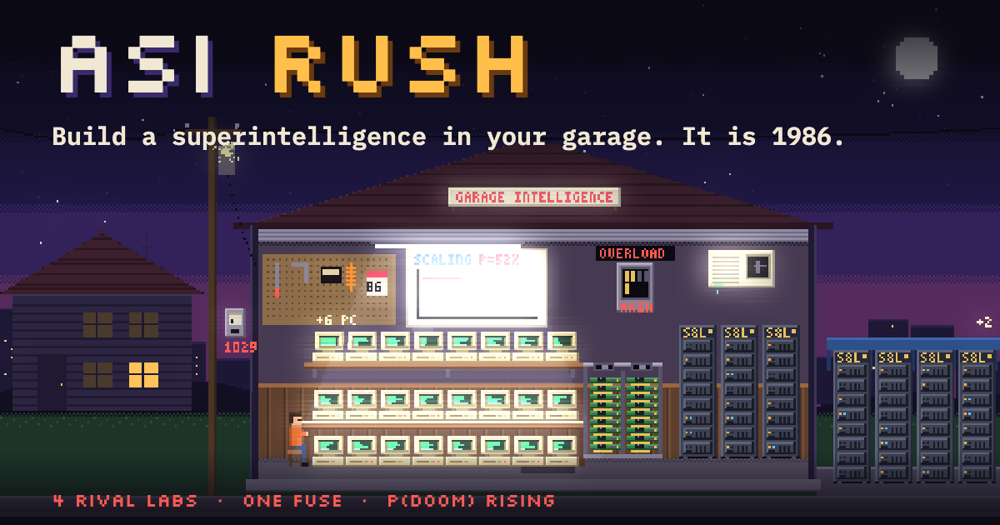

# ASI RUSH

An incremental game about the AI race, set in an alternate 1986. Four labs are racing to build Artificial
Superintelligence. You have a garage, a credit card and no adult supervision.

**Play:** https://ponzgpt.github.io/asi-rush/ (about 25–35 minutes for Era I; English and Spanish)



## What you do

1. **Run benchmarks** for your first dollars.
2. **Buy hardware** (Home PCs, accelerator cards, server racks) for compute — and a bigger fuse when the
   neighbourhood lights start to dim.
3. **Split compute** between serving (cash) and training (Capability, with diminishing returns).
4. **Publish research** (backprop, RLHF, a leaked fax about attention) and **ship models** that charge more per token.
5. **Race four rival labs** to 1,000 Capability and close your Series A. Watch P(doom) on the way.

Saves every 30 s, keeps training while you are away (up to 24 h), export/import from Settings.
Original pixel art and synthesized audio — no asset files. Space runs a benchmark. Spec: [docs/SPEC.md](docs/SPEC.md).

## Run

```bash
npm install
npm run dev        # http://localhost:5173/asi-rush/
```

## Test

```bash
npm run check      # lint + prettier + vitest + typecheck + build (what CI runs)
npm test           # sim and balance tests only
```

## Simulate

```bash
npm run sim -- 4 0.5 5 --timeline   # hours, training share, clicks/s → CSV of milestones (+ per-minute timeline)
```

Results and tuning notes: [docs/BALANCE.md](docs/BALANCE.md).

## Deploy

Every push to `main` runs `.github/workflows/deploy.yml`: install → check → build → GitHub Pages.

## How this was made

I'm a vibe coder. I decide what to build, write the spec and the rules it has to follow, and test the result until it
does what I said. AI coding agents write the code; I don't write code by hand. Commits under my name were made by an
agent working for me.

## License

Code: [MIT](LICENSE).
